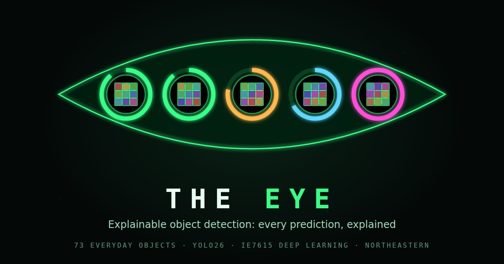

# THE EYE: Explainable YOLO Explorer

An object detector for 73 everyday objects that explains every prediction: what it found, what it missed, and why.

**Live demo:** [the-eye-detector.duckdns.org](https://the-eye-detector.duckdns.org)

[](https://the-eye-detector.duckdns.org)

## What it does

- **A verdict for every object.** Each box is marked correct, wrong ID, missed or extra, with its confidence, so errors are as visible as successes.
- **COMPOUND model comparison.** Four detectors and the Milestone 1 classifier look at the same picture side by side, with a per-object count of how many models got it right.
- **Stress test.** Runs a detector on many random grids in a row, optionally blurred, darkened, shrunk or heavily compressed, and reports how often it is fully correct and which objects it misses most.
- **Sphere pupil.** The picture is wrapped onto a sphere inside an animated eye, which zooms in on the result after each detection.
- **Guided tour.** A step-by-step walkthrough that points at each control in turn.
- **Upload.** Visitors can upload their own photo, next to a searchable list of the 73 objects with an example photo of each.

## Results

From the [final report](docs/IE7615_Final_Report_Group7.pdf), Section 7.3 "Final results", Table 9 (mAP@0.5 also in Appendix B, Table 20). The selected model is `boost` (`yolo26s_boost`); the earlier model is the Milestone 2 detector (`yolo26s_ft2`). All figures are measured on the held-out test sets after every test box was checked by a person (answer key T3, final settings), with 95% bootstrap intervals in brackets.

| Measure | Milestone 2 model | boost |
|---|---|---|
| Test mAP@0.5, normal grids | 0.947 | **0.971** |
| Recall, rotated grids | 0.756 [0.743, 0.769] | **0.922** [0.914, 0.930] |
| Recall, cut-out objects on new backgrounds | 0.368 [0.339, 0.397] | **0.881** [0.862, 0.901] |

- **mAP@0.5:** mean average precision, counting a box as correct when it overlaps the true box by at least 50 percent.
- **Recall, rotated grids:** share of objects found when the whole grid of photos is rotated.
- **Recall, cut-out objects:** share of objects found when each object is cut out of its photo and placed on an unseen background.

## How it was built

1. **Classifier:** CNNs compared for 73-class recognition; a fine-tuned ConvNeXt-Tiny was selected.
2. **Labelling pipeline and detector:** bounding boxes from OWLv2 and a self-trained detector, reviewed by people, then a YOLO detector trained on grids of photos.
3. **Diagnosing and fixing failures:** every box checked by hand, harder training scenes (rotated, scattered, SAM 2.1 cut-outs), and the model chosen by a rule fixed in advance.
4. **THE EYE and deployment:** the explainable interface, served over HTTPS from an Oracle Cloud server.

## Tech

PyTorch, Ultralytics YOLO, OWLv2, SAM 2.1, a Python HTTP server, hand-written HTML/CSS/JavaScript/SVG, Caddy, Oracle Cloud.

## Repository layout

```
app/          THE EYE application (m2_eye_app_v35.py, the build running live) and its Windows launcher
deploy/       server setup script, systemd service, deployment guide and the prompt used to assemble the bundle
docs/         final report, course lesson pages, the original group README and the preview image
Milestone_1/  classifier: pipeline, experiments, outputs and report (from the group repository)
Milestone_2/  detector: labelling pipeline, experiments, outputs and report (from the group repository)
Milestone_3/  label check, boost models, selection and the first versions of THE EYE (from the group repository)
```

## Running locally

THE EYE needs the course dataset and the trained model weights, which are not public, so it cannot run from this repository alone. The live demo is the way to try it.

## Team and credits

Santhoshkumar Chandrasekar, Tanmayi Shurpali, Praniti Kale.

IE7615 Deep Learning, Northeastern University, with Professor Xuemin Jin.

This repository continues the history of the original group repository: [tanmayi123/Discriminative-Project-Deep-Learning](https://github.com/tanmayi123/Discriminative-Project-Deep-Learning).
